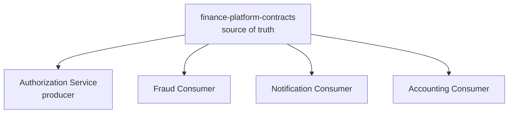

# finance-platform-contracts

**Source of truth** dos contratos públicos entre os microsserviços da
plataforma financeira orientada a eventos.

- Repositório: <https://github.com/Whoo-Internet-co/finance-platform-contracts>
- Package npm (GitHub Packages): `@whoo-internet-co/finance-platform-contracts`

## 1. Propósito

Governança centralizada dos contratos de integração da plataforma. Este
repositório distribui **exclusivamente artefatos de contrato**:

- JSON Schemas de eventos;
- documentos OpenAPI;
- exemplos válidos e inválidos;
- metadados necessários à validação.

**Não contém lógica de domínio compartilhada** nem entidades TypeScript com
comportamento. Os tipos TS exportados são artefatos **derivados/gerados** dos
schemas (ver seção 8).

## 2. Source of truth

O contrato **não pertence** ao producer nem a nenhum consumer — pertence a
este repositório. Producers e consumers validam contra os artefatos daqui,
sempre em **versões explícitas** do package:

```json
{
  "dependencies": {
    "@whoo-internet-co/finance-platform-contracts": "1.0.0"
  }
}
```



Contexto de runtime (a entrega é `AT-LEAST-ONCE` — consumidores devem ser
idempotentes, tolerantes a duplicação/reentrega e a evolução retrocompatível):

```
Authorization Service
        |
        v
Amazon EventBridge
        |
        +-------------------+
        |         |         |
        v         v         v
       SQS       SQS       SQS
        |         |         |
        v         v         v
   Accounting   Fraud   Notification
```

## 3. Estrutura

```
finance-platform-contracts/
├── events/
│   └── transacao-autorizada/
│       └── v1/
│           ├── schema.json              # JSON Schema canônico (source of truth)
│           ├── example.json             # exemplo válido oficial
│           ├── invalid-examples/        # fixtures inválidas para testes
│           └── README.md                # campos, políticas, CloudEvents
├── openapi/
│   └── authorization/
│       └── v1/
│           └── openapi.yaml             # contrato contract-first da API
├── src/
│   ├── index.ts                         # caminhos + loaders (sem domínio)
│   └── generated/                       # tipos TS GERADOS dos schemas (build)
├── tests/
│   ├── schemas/                         # testes de validação (AJV)
│   └── compatibility/                   # baseline + verificação de compatibilidade
├── scripts/
│   ├── validate-contracts.ts            # npm run validate
│   └── generate-types.mjs               # geração de tipos derivados
├── docs/
│   ├── adr/
│   │   └── ADR-001-centralized-contract-registry.md  # decisão de arquitetura
│   └── versioning.md                    # política SemVer
├── .github/
│   ├── workflows/validate.yml           # CI: lint, test, validate, build
│   ├── workflows/publish.yml            # publicação por tag v*
│   └── CODEOWNERS
├── package.json
├── tsconfig.json
└── LICENSE
```

## 4. Eventos disponíveis

| Evento | Versão | Schema | Exemplo |
| --- | --- | --- | --- |
| `TransacaoAutorizada` | v1 (`1.x`) | [schema.json](events/transacao-autorizada/v1/schema.json) | [example.json](events/transacao-autorizada/v1/example.json) |

Producer: **Authorization Service**. Consumers: **Accounting**, **Fraud**,
**Notification**. Detalhes de campos, política de `additionalProperties` e
idempotência: [events/transacao-autorizada/v1/README.md](events/transacao-autorizada/v1/README.md).

## 5. APIs disponíveis

| API | Versão | Documento |
| --- | --- | --- |
| Authorization Service | v1 | [openapi.yaml](openapi/authorization/v1/openapi.yaml) |

`POST /v1/contratos/{id_contrato}/autorizacoes` — contract-first, header
`Idempotency-Key` obrigatório, respostas `200/201/402/409/422/429/503`, erros
em **RFC 7807 (Problem Details, `application/problem+json`)**. Este repositório
contém apenas o contrato — não há implementação.

## 6. Instalação

O package é **privado** e hospedado no GitHub Packages. É necessário
autenticar (ver seção 7).

```bash
npm install @whoo-internet-co/finance-platform-contracts@1.0.0
```

## 7. GitHub Packages

Packages privados exigem autenticação mesmo para **instalação**. Configure um
`.npmrc` **no projeto consumidor** (nunca commite tokens):

```
@whoo-internet-co:registry=https://npm.pkg.github.com
//npm.pkg.github.com/:_authToken=${GITHUB_TOKEN}
```

O token precisa do escopo `read:packages` (PAT clássico ou fine-grained com
acesso ao repositório). Em CI, use um secret. **Nenhuma credencial é
versionada neste repositório.**

## 8. Import / uso

Subpath exports explícitos:

```ts
// Caminhos e loaders (entrypoint principal)
import {
  contractPaths,
  loadTransacaoAutorizadaV1Schema,
  loadTransacaoAutorizadaV1Example,
  loadAuthorizationOpenApiV1,
} from '@whoo-internet-co/finance-platform-contracts';

// Tipo estrutural DERIVADO do schema (gerado automaticamente)
import type { TransacaoAutorizada } from '@whoo-internet-co/finance-platform-contracts';

// Acesso direto aos artefatos (subpath exports)
import schema from '@whoo-internet-co/finance-platform-contracts/events/transacao-autorizada/v1/schema' with { type: 'json' };
import example from '@whoo-internet-co/finance-platform-contracts/events/transacao-autorizada/v1/example' with { type: 'json' };
// OpenAPI (YAML): caminho via contractPaths.openapi.authorization.v1
```

| Subpath | Artefato |
| --- | --- |
| `.../events/transacao-autorizada/v1/schema` | JSON Schema TransacaoAutorizada v1 |
| `.../events/transacao-autorizada/v1/example` | Exemplo válido oficial |
| `.../openapi/authorization/v1` | OpenAPI Authorization v1 (YAML) |

> O `schema.json` é a **source of truth**. Os tipos TypeScript são gerados dele
> no build (`json-schema-to-typescript`) — nunca mantidos manualmente, para
> evitar contract drift.

## 9. Validação

```bash
npm ci
npm run lint      # ESLint
npm test          # Vitest: schemas + compatibilidade
npm run validate  # exemplos válidos/inválidos + OpenAPI (AJV + swagger-parser)
npm run build     # gera tipos derivados + compila (tsc)
```

## 10. Versionamento

SemVer estrito — política completa em [docs/versioning.md](docs/versioning.md)
e decisão arquitetural em [docs/adr/ADR-001-centralized-contract-registry.md](docs/adr/ADR-001-centralized-contract-registry.md):

- **PATCH**: documentação, correções sem alterar contrato observável;
- **MINOR**: mudanças backward-compatible (novos campos opcionais, novos
  exemplos compatíveis);
- **MAJOR**: breaking changes (remoção de campos, mudança de tipo, opcional →
  obrigatório, mudança de semântica).

Uma versão publicada **nunca é sobrescrita**. Tags `vX.Y.Z` devem ser idênticas
a `package.json.version` (o publish falha se divergirem).

## 11. Backward compatibility

- `additionalProperties: true` no schema de eventos: consumidores **devem
  ignorar campos desconhecidos** (tolerant reader). Isso permite adicionar
  campos opcionais em MINOR sem quebrar consumidores antigos.
- `event_version` aceita `1.x` (`^1\.\d+$`): MINORs dentro de v1 são
  retrocompatíveis; `2.x` falha explicitamente em consumidores de v1.
- Verificação automatizada conservadora em `tests/compatibility/` (schema
  atual vs baseline 1.0.0). **Limitação:** verificação parcial — a garantia
  final é a revisão arquitetural no PR. Limitações detalhadas no próprio teste.

## 12. Processo para alterar um contrato

1. Abra um PR alterando os artefatos em `/events/` ou `/openapi/`;
2. Atualize `package.json.version` conforme a política SemVer;
3. CI (`validate.yml`) deve ficar verde — inclui testes de compatibilidade;
4. Aprovação obrigatória dos CODEOWNERS (revisão arquitetural);
5. Merge → criar tag `vX.Y.Z` → `publish.yml` publica no GitHub Packages.

## 13. Como criar v2

Breaking changes **não** entram em v1. Para evoluir incompativelmente:

1. Crie `events/transacao-autorizada/v2/` com o novo schema, exemplos e README;
2. `event_version` passa a `2.0` (pattern `^2\.\d+$`);
3. Mantenha v1 intacta e publicada durante a migração dos consumidores;
4. Adicione exports no `package.json` para a v2;
5. Release **MAJOR** do package (`2.0.0`);
6. Consumers migram explicitamente para a nova versão do package; v1 é
   descontinuada apenas após todos migrarem (decisão coordenada).

## 14. Producer contract testing

O Authorization Service valida cada evento produzido contra o schema oficial
antes de publicar (e em testes):

```
Producer
   |
   v
produced event
   |
   v
official schema (do package, versão pinada)
   |
   v
PASS / FAIL
```

```ts
import Ajv from 'ajv';
import addFormats from 'ajv-formats';
import { loadTransacaoAutorizadaV1Schema } from '@whoo-internet-co/finance-platform-contracts';

const ajv = new Ajv({ allErrors: true });
addFormats(ajv);
const validate = ajv.compile(await loadTransacaoAutorizadaV1Schema());
if (!validate(eventoProduzido)) throw new Error(ajv.errorsText(validate.errors));
```

## 15. Consumer contract testing

Fraud/Notification/Accounting testam desserialização e tolerância contra o
schema e o exemplo oficiais:

```
Consumer
   |
   v
official schema/example (do package, versão pinada)
   |
   v
consumer contract test
```

Recomendações: testar o `example.json` oficial, testar tolerância a campos
desconhecidos e testar deduplicação por `event_id` (entrega at-least-once).

## 16. Relação com AWS Schema Registry

**Não provisionamos** AWS Glue/EventBridge Schema Registry neste repositório —
a infraestrutura AWS pertence a outro projeto.

Este repositório/package é a **source of truth no ciclo de desenvolvimento**.
A arquitetura **pode** sincronizar/registrar os schemas no registry AWS durante
o deployment (pipeline de infra do producer). Essa integração **não está
implementada aqui** — é uma possibilidade futura documentada, não uma garantia
existente.

## 17. CloudEvents

A arquitetura alvo prevê envelope **CloudEvents 1.0**. O contrato v1 é um
payload *flat* que já carrega metadados equivalentes (`event_id` ↔ `id`,
`event_type` ↔ `type`, `occurred_at` ↔ `time`, etc.) — decisão para preservar
compatibilidade, sem breaking change silencioso.

- Mapeamento do evento para os atributos CloudEvents 1.0 e a distinção
  **envelope técnico × payload de negócio** (conforme ADR-008):
  [docs/cloudevents-mapping.md](docs/cloudevents-mapping.md).
- Mapeamento completo e plano de convergência (transição com duplicação
  intencional e temporária → v2 com envelope puro):
  [events/transacao-autorizada/v1/README.md](events/transacao-autorizada/v1/README.md#relação-com-cloudevents).

## 18. Limitações atuais

- Verificação de compatibilidade é **conservadora e parcial** (não prova
  compatibilidade total; ex.: não detecta restrições numéricas mais rígidas);
- Sem verificação automatizada de compatibilidade do **OpenAPI** (apenas
  eventos JSON Schema);
- Convergência para CloudEvents **não implementada** (apenas documentada);
- Sincronização com AWS Schema Registry **não implementada**;
- O time `architecture-team` ainda não existe — CODEOWNERS aponta para
  `@Whoo-Internet-co/owners` até que seja criado;
- Branch protection/rulesets **não configurados** (plano GitHub atual não
  permite em repo privado — ver Governança).

## Governança e segurança

- **Nenhuma credencial** é versionada neste repositório.
- **CODEOWNERS**: `/events/` e `/openapi/` → `@Whoo-Internet-co/owners`
  (substituir por `@Whoo-Internet-co/architecture-team` quando o time existir).
- **Branch protection** (recomendado na `main`):
  - PR obrigatório antes de merge;
  - check `validate` (workflow `validate.yml`) obrigatório;
  - revisão arquitetural obrigatória para mudanças em contratos (CODEOWNERS).

  > **Pendência:** a proteção de branch/rulesets exige plano GitHub pago para
  > repositórios privados (ou tornar o repo público). Não foi possível
  > configurar via API no plano atual — as recomendações acima devem ser
  > aplicadas manualmente em *Settings → Branches* quando o plano permitir.

## Licença

[MIT](LICENSE)
